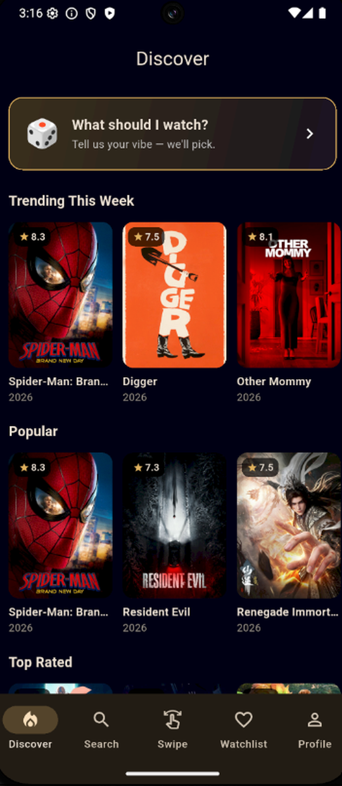
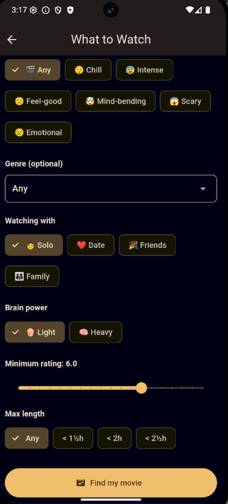
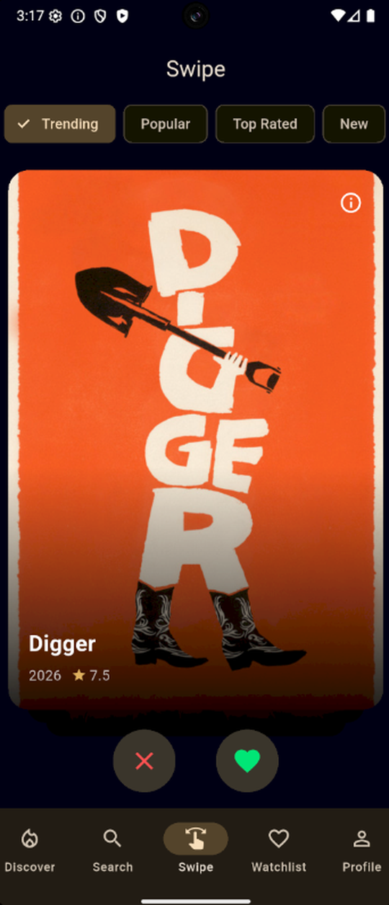
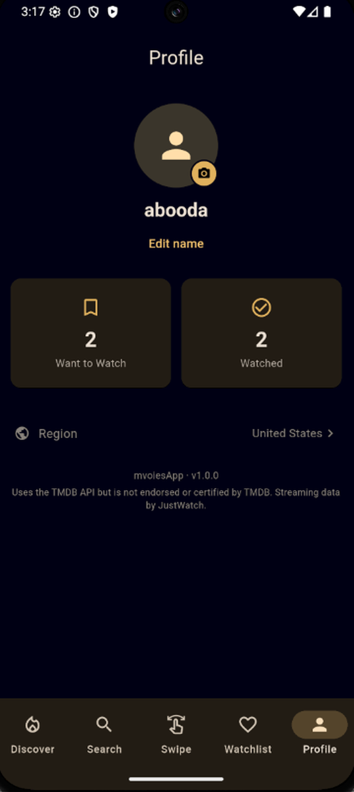

# 🎬 mvoiesApp

A movie discovery app built with Flutter that helps you decide **what to watch tonight** — not just search for films, but actually pick one. Search, browse, swipe, get personalized recommendations, and track everything in a watchlist, with real-time streaming availability for your country.

Built for **iOS & Android** from a single Flutter codebase, powered by the [TMDB API](https://www.themoviedb.org/).

---

## 📸 Screenshots

<p align="center">
  
  
  
  
</p>

<p align="center"><em>Discover &nbsp;·&nbsp; What Should I Watch? &nbsp;·&nbsp; Swipe Discovery &nbsp;·&nbsp; Profile</em></p>

---

## ✨ Features

- **🔍 Search** — Find any movie with a debounced live search; tap through to full details.
- **🎬 Movie Details** — Poster, backdrop, rating, runtime, genres, overview, cast, director, trailer (opens in YouTube), and **where to watch**.
- **📺 Streaming availability** — See which services have each movie to **Stream / Rent / Buy**, powered by JustWatch data and localized to your region.
- **🔥 Discover** — Browse Trending, Popular, Top Rated, and Now Playing in smooth horizontal rails.
- **👆 Swipe Discovery** — A Tinder-style card stack with themed sessions: swipe right to save, left to skip.
- **🎲 What Should I Watch?** — The recommender. Pick a mood, genre, runtime, minimum rating, who you're watching with, and how much brain you've got — and it suggests one great movie. Plus a one-tap **Surprise Me**.
- **❤️ Watchlist** — Save movies and organize them as *Want to Watch* / *Watched*, with personal notes. Persists locally across app restarts.
- **👤 Profile** — Profile photo, watchlist stats, and an auto-detected region (which drives accurate streaming results).

---

## 🏗️ Architecture

mvoiesApp uses a **feature-first, layered architecture** — the kind that scales cleanly and keeps features isolated.

```
lib/
├── app/          # MainShell — the bottom-nav app shell
├── core/         # app-wide plumbing
│   ├── config/   #   API config (secrets gitignored)
│   ├── constants/#   TMDB endpoints & image URLs
│   ├── network/  #   configured Dio client (+ auto-retry) exposed via Riverpod
│   ├── storage/  #   SharedPreferences provider
│   └── theme/    #   Material 3 dark theme
├── features/     # one folder per feature, each split into:
│   │             #   data/        → repositories + models
│   │             #   presentation/→ Riverpod providers + screens/widgets
│   ├── search/
│   ├── movie_details/
│   ├── discover/
│   ├── swipe/
│   ├── watchlist/
│   ├── recommend/
│   └── profile/
├── shared/       # cross-feature Movie model + reusable MovieCard
└── main.dart
```

**The one rule everything follows:** UI → Riverpod provider → repository → (Dio | SharedPreferences) → source. The UI never touches the network, JSON, or storage directly — which keeps screens dumb, testable, and easy to change.

A few engineering details I'm happy with:
- A **Dio interceptor** injects the API key on every request, so no screen ever handles auth.
- **Automatic retry** on transient failures (TMDB occasionally 500s on valid requests) — retries quietly before ever showing the user an error.
- The **watchlist** lives behind a repository, so its storage engine (currently `shared_preferences`) can be swapped for Hive/Isar later without touching any UI.
- **Region auto-detection** flows through a single Riverpod provider — change it once, and streaming availability updates everywhere.

---

## 🛠️ Tech Stack

| Concern | Choice |
|---|---|
| Framework | Flutter (Material 3) |
| Language | Dart |
| State management | [Riverpod](https://riverpod.dev/) 3 |
| Networking | [Dio](https://pub.dev/packages/dio) (with interceptors + retry) |
| Local storage | [shared_preferences](https://pub.dev/packages/shared_preferences) |
| Images | [cached_network_image](https://pub.dev/packages/cached_network_image) |
| Swipe cards | [flutter_card_swiper](https://pub.dev/packages/flutter_card_swiper) |
| Data source | [TMDB API](https://developer.themoviedb.org/) |

---

## 🚀 Getting Started

**Prerequisites:** [Flutter SDK](https://docs.flutter.dev/get-started/install) installed, and a free [TMDB API key](https://www.themoviedb.org/settings/api).

```bash
# 1. Clone the repo
git clone https://github.com/aboodmanasra/movies_app.git
cd movies_app

# 2. Add your TMDB API key
#    Copy the template, then paste your key into the new file:
cp lib/core/config/api_config.example.dart lib/core/config/api_config.dart
#    (edit api_config.dart and replace YOUR_TMDB_API_KEY_HERE)

# 3. Install dependencies
flutter pub get

# 4. Run it
flutter run
```

> 🔐 `lib/core/config/api_config.dart` holds your real key and is **gitignored** — it never gets committed. The repo only ships the `.example` template.

---

## 📄 Credits & License

Movie data and images provided by [The Movie Database (TMDB)](https://www.themoviedb.org/) and streaming availability by [JustWatch](https://www.justwatch.com/). This product uses the TMDB API but is **not endorsed or certified by TMDB**.

Released under the [MIT License](LICENSE).
